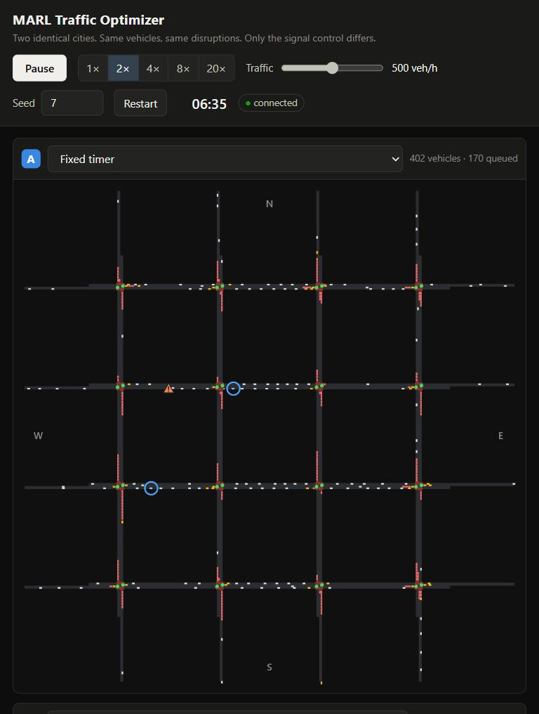
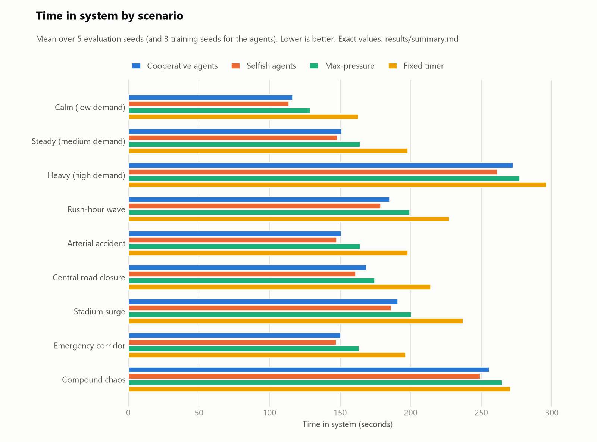
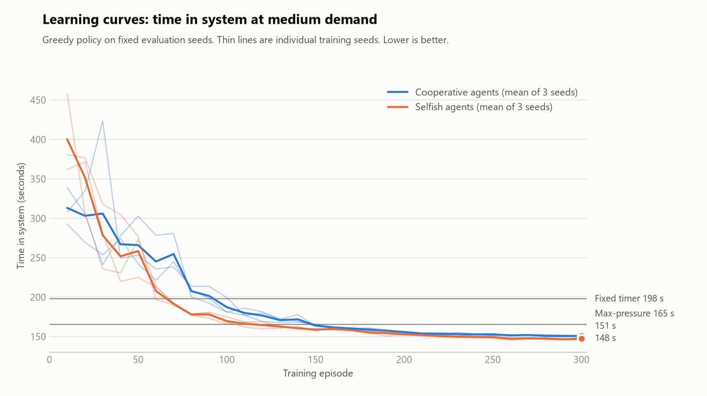
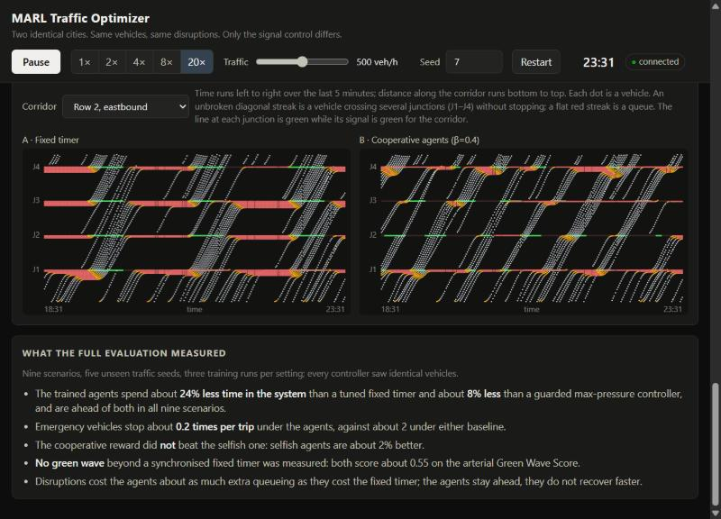

# MARL Traffic Optimizer

A live "digital twin" of a 4×4 city grid in which every intersection is its own reinforcement-learning agent. There is no central controller: each of the 16 agents sees only its own junction plus a little information from its neighbours, and decides which signal phase should be green.

The browser interface runs **two identical cities side by side** with exactly the same vehicles. One is run by a conventional controller, the other by the trained agents, and you can throw accidents, road closures, surges and emergency vehicles at both and watch what happens.



## Results

Nine scenarios, five unseen traffic seeds, three training runs per setting. Every controller sees identical vehicles, so differences come from signal control alone.

Time in system at medium demand (seconds per vehicle, lower is better):

| Controller | Time in system | vs fixed timer | Emergency-vehicle stops per trip |
|---|---|---|---|
| Selfish agents (β = 0) | 148.0 | −25.2 % | 0.15 |
| Cooperative agents (β = 0.4) | 150.9 | −23.7 % | 0.22 |
| Max-pressure | 164.2 | −17.0 % | 2.36 |
| Fixed timer | 197.9 | — | 2.10 |
| Random signals | 619.5 | +213 % | 14.40 |

<picture>
  <source media="(prefers-color-scheme: dark)" srcset="docs/figures/scenario_comparison_dark.png">
  
</picture>

What held up:

- **The agents beat both baselines in all nine scenarios.** About 24 % less time in the system than a tuned fixed timer and about 8 % less than max-pressure at medium demand.
- **Emergency priority is clearly learned.** Emergency vehicles stop about 0.2 times per trip instead of about 2.
- **It learns quickly on a laptop.** 300 episodes take about half an hour on a CPU; the agents pass the fixed timer after roughly 65–95 episodes.

What did not:

- **Cooperation did not help.** Sharing 40 % of each agent's reward with its neighbours was meant to produce coordination. Selfish agents turned out about 2 % better, on all three training seeds. The agents already observe their neighbours' phases and their own exits, so the shared reward mostly added noise.
- **No "green wave" was measured.** The share of arterial junctions crossed without stopping is 0.55 for the agents and 0.55 for the fixed timer, whose lights simply all change together.
- **The agents do not absorb disruptions better.** A surge costs every controller the same extra queueing, and when several things go wrong at once the adaptive controllers lose more than the fixed timer does. They stay ahead in absolute terms; they do not recover faster.

<picture>
  <source media="(prefers-color-scheme: dark)" srcset="docs/figures/learning_curves_dark.png">
  
</picture>

Full tables are in [results/summary.md](results/summary.md), raw rows in [results/results.csv](results/results.csv).

## Run it

Requires Python 3.12. Everything runs locally on a CPU.

```bash
py -3.12 -m venv .venv
.venv\Scripts\python.exe -m pip install -r requirements.txt
.venv\Scripts\python.exe -m server.app
```

Then open <http://127.0.0.1:8000>. On Linux or macOS use `.venv/bin/python` instead.

The trained policies are included in `checkpoints/`, so nothing needs to be trained first.

## The interface



- **Two live maps** that pan and zoom together (drag, Ctrl + scroll). Each city has its own controller menu.
- **Learning timeline:** put the policy from any stage of training into city B, from untrained to fully trained.
- **Disrupt both cities:** click a road to cause an accident, close it, or drop a traffic jam; trigger a surge from any edge; send an emergency vehicle; play a scripted scenario; or unleash one of the worst cases an adversarial search found.
- **Live comparison:** seven measures side by side, three rolling charts, and an event log.
- **Corridor view:** a time–space diagram of any row or column. Vehicles that cross junctions without stopping draw unbroken diagonal streaks; queues draw flat red ones.

## How it works

**Simulator.** A vectorised microscopic simulator written in NumPy: vehicles follow the Intelligent Driver Model, obey signals and yellow lights, turn from dedicated lanes, re-route around closures and change lanes around accidents. It runs at about 3,000 steps per second, so a 30-minute episode simulates in about a second.

**Agents.** Each intersection chooses one of four conflict-free phases every 5 seconds. It observes 81 numbers: queues, waiting time, approaching traffic and emergency vehicles on its own lanes, how full its exits are, and the phase and outgoing traffic of its four neighbours. The agents are independent Double-Dueling DQN learners with n-step returns and action masking; they share one small network (about 150,000 parameters) but act only on their own observation.

**Reward.** Penalties for halted vehicles, halted emergency vehicles, starving any single lane, wasting green into a blocked exit and needless switching; a reward for throughput. A cooperation weight β mixes in the neighbours' reward (β = 0.4 "cooperative", β = 0 "selfish").

**Baselines.** A fixed timer and a max-pressure controller, both tuned over three demand levels so neither is a strawman. Textbook max-pressure left some vehicles waiting for many minutes, so it has a waiting-time guard.

**Fair comparison.** Vehicle arrivals come from a random stream that does not depend on the signals, so every controller receives exactly the same traffic and the same disruptions.

**Adversary.** A cross-entropy search over bounded disruption scenarios looks for the ones where the trained policy does worst relative to max-pressure. Unperturbed, the policy is about 15 s ahead; the worst case found leaves it 1.2 s behind. All five worst cases include a road closure.

## Reproduce the results

```bash
.venv\Scripts\python.exe -m training.launch --seeds 0 1 2 --threads 2 --wait
.venv\Scripts\python.exe -m training.evaluate --groups cooperative selfish --promote
.venv\Scripts\python.exe -m training.plots
.venv\Scripts\python.exe -m training.adversary_search
```

The first command trains six policies in parallel (about 35 minutes on a 16-thread laptop). A single short run to see the pipeline work:

```bash
.venv\Scripts\python.exe -m training.train --config configs/smoke.yaml --name smoke
```

## Tests

```bash
.venv\Scripts\python.exe -m core.selfcheck
.venv\Scripts\python.exe -m pytest
```

The self-check verifies the simulator's invariants on live runs: vehicles are conserved, never overlap and never cross on red; conflicting phases are never green together; identical seeds give identical runs; every controller receives identical traffic; and more (57 checks in about 40 seconds).

## Layout

| Path | Contents |
|---|---|
| `core/` | simulator, signals, demand, observation, reward, environment, baselines, metrics, scenarios, adversary, agents |
| `training/` | training, parallel launcher, evaluation, charts, adversary search |
| `server/` | FastAPI server and the WebSocket protocol |
| `web/` | the browser interface (plain HTML, CSS and JavaScript modules, no build step) |
| `configs/` | YAML overrides for the cooperative, selfish and smoke runs |
| `checkpoints/` | trained policies and the training snapshots used by the learning timeline |
| `results/`, `docs/figures/` | evaluation tables and charts |
| `scenarios/adversarial/` | the worst cases found by the adversary |
| `tests/` | pytest suite |

## Limitations

- One city layout (a 4×4 grid with two lanes per direction) and one family of demand patterns. Nothing here says how the agents would do on a real road network.
- Results come from three training seeds per setting; differences of a percent or two between settings are small.
- The cooperation weight was tested at two values only (0 and 0.4).
- The simulator is deliberately simple: no pedestrians, no right turn on red, lane changes only around obstacles.
- The server is a local demo. All browser windows share one simulation, and it should not be exposed to a network.
